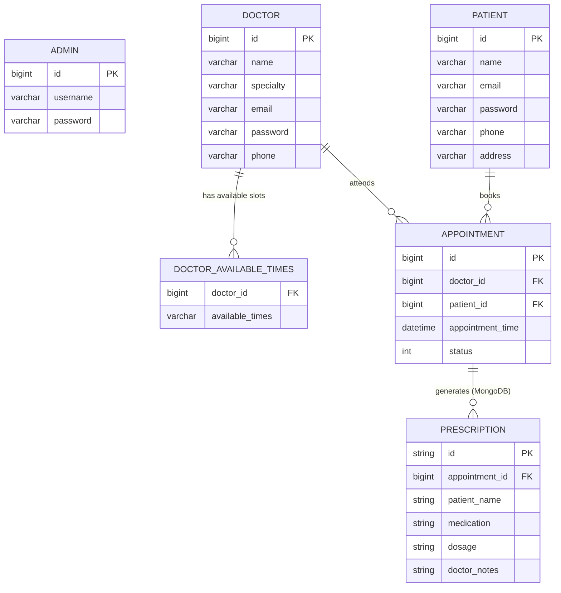

# Database Schema Design - Smart Clinic Management System

## 1. System Overview & Architecture

The **Smart Clinic Management System** employs a polyglot persistence architecture combining a relational database (**MySQL**) and a document-oriented NoSQL database (**MongoDB**).

- **MySQL**: Serves as the primary operational relational data store for structured transactional data requiring ACID compliance, referential integrity, and relational joins (Admins, Doctors, Patients, Appointments, and Schedule Availability).
- **MongoDB**: Serves as a flexible document store for semi-structured medical documentation, specifically **Prescriptions**, allowing fast reads/writes and flexible schema extension for medication regimens and clinical notes.



---

## 2. Relational Database Schema (MySQL)

### 2.1 Table: `admin`
Stores system administrators who manage doctor onboarding and platform governance.

| Column Name | Data Type | Constraints | Description |
| :--- | :--- | :--- | :--- |
| `id` | `BIGINT` | `PRIMARY KEY`, `AUTO_INCREMENT` | Unique identifier for admin |
| `username` | `VARCHAR(255)` | `NOT NULL` | Admin username for login |
| `password` | `VARCHAR(255)` | `NOT NULL` | Admin password |

---

### 2.2 Table: `doctor`
Stores profiles and credentials of licensed medical practitioners.

| Column Name | Data Type | Constraints | Description |
| :--- | :--- | :--- | :--- |
| `id` | `BIGINT` | `PRIMARY KEY`, `AUTO_INCREMENT` | Unique doctor identifier |
| `name` | `VARCHAR(100)` | `NOT NULL`, Length: 3-100 | Full name of the doctor |
| `specialty` | `VARCHAR(50)` | `NOT NULL`, Length: 3-50 | Medical specialty (e.g., Cardiology, Pediatrics) |
| `email` | `VARCHAR(255)` | `NOT NULL`, `UNIQUE`, Valid Email | Doctor's primary contact & login email |
| `password` | `VARCHAR(255)` | `NOT NULL`, Min length: 6 | Authentication password (write-only) |
| `phone` | `VARCHAR(255)` | `NOT NULL`, Regex: `^[0-9]{10}$` | 10-digit primary contact phone number |

---

### 2.3 Table: `doctor_available_times`
Normalized collection table capturing time slots during which a doctor is available for consultations.

| Column Name | Data Type | Constraints | Description |
| :--- | :--- | :--- | :--- |
| `doctor_id` | `BIGINT` | `NOT NULL`, `FOREIGN KEY` (`doctor.id`) | Reference to the doctor |
| `available_times` | `VARCHAR(255)` | | Time slot string representation (e.g., `"09:00-10:00"`) |

*Foreign Key:*
- `FK_doctor_available_times_doctor`: `doctor_id` references `doctor(id)` on delete cascade.

---

### 2.4 Table: `patient`
Maintains records and contact details of registered patients.

| Column Name | Data Type | Constraints | Description |
| :--- | :--- | :--- | :--- |
| `id` | `BIGINT` | `PRIMARY KEY`, `AUTO_INCREMENT` | Unique patient identifier |
| `name` | `VARCHAR(100)` | `NOT NULL`, Length: 3-100 | Full name of the patient |
| `email` | `VARCHAR(255)` | `NOT NULL`, `UNIQUE`, Valid Email | Patient login & notification email |
| `password` | `VARCHAR(255)` | `NOT NULL`, Min length: 6 | Authentication password |
| `phone` | `VARCHAR(255)` | `NOT NULL`, Regex: `^[0-9]{10}$` | 10-digit phone number |
| `address` | `VARCHAR(255)` | `NOT NULL`, Max length: 255 | Residential address |

---

### 2.5 Table: `appointment`
Tracks scheduled appointments linking doctors and patients.

| Column Name | Data Type | Constraints | Description |
| :--- | :--- | :--- | :--- |
| `id` | `BIGINT` | `PRIMARY KEY`, `AUTO_INCREMENT` | Unique appointment identifier |
| `doctor_id` | `BIGINT` | `NOT NULL`, `FOREIGN KEY` (`doctor.id`) | Assigned doctor |
| `patient_id` | `BIGINT` | `NOT NULL`, `FOREIGN KEY` (`patient.id`) | Booking patient |
| `appointment_time` | `DATETIME(6)` | `NOT NULL` | Scheduled appointment start timestamp |
| `status` | `INT` | `NOT NULL` | Status code: `0` = Scheduled, `1` = Completed |

*Foreign Keys:*
- `FK_appointment_doctor`: `doctor_id` references `doctor(id)`
- `FK_appointment_patient`: `patient_id` references `patient(id)`

---

## 3. Stored Procedures Specification (MySQL)

To optimize complex analytics and reporting, three stored procedures are defined in MySQL:

### 3.1 `GetDailyAppointmentReportByDoctor`
Generates a daily appointment schedule for a specific doctor on a target date.
```sql
DELIMITER $$

CREATE PROCEDURE GetDailyAppointmentReportByDoctor(
    IN doctorId BIGINT,
    IN reportDate DATE
)
BEGIN
    SELECT 
        a.id AS appointment_id,
        p.name AS patient_name,
        a.appointment_time,
        a.status
    FROM appointment a
    JOIN patient p ON a.patient_id = p.id
    WHERE a.doctor_id = doctorId
      AND DATE(a.appointment_time) = reportDate
    ORDER BY a.appointment_time ASC;
END $$

DELIMITER ;
```

### 3.2 `GetDoctorWithMostPatientsByMonth`
Finds the top performing doctor with the highest count of unique patients in a given month and year.
```sql
DELIMITER $$

CREATE PROCEDURE GetDoctorWithMostPatientsByMonth(
    IN inputMonth INT,
    IN inputYear INT
)
BEGIN
    SELECT 
        d.id AS doctor_id,
        d.name AS doctor_name,
        d.specialty,
        COUNT(DISTINCT a.patient_id) AS unique_patients,
        COUNT(a.id) AS total_appointments
    FROM doctor d
    JOIN appointment a ON d.id = a.doctor_id
    WHERE MONTH(a.appointment_time) = inputMonth
      AND YEAR(a.appointment_time) = inputYear
    GROUP BY d.id, d.name, d.specialty
    ORDER BY unique_patients DESC, total_appointments DESC
    LIMIT 1;
END $$

DELIMITER ;
```

### 3.3 `GetDoctorWithMostPatientsByYear`
Identifies the doctor who attended the highest number of unique patients over an entire calendar year.
```sql
DELIMITER $$

CREATE PROCEDURE GetDoctorWithMostPatientsByYear(
    IN inputYear INT
)
BEGIN
    SELECT 
        d.id AS doctor_id,
        d.name AS doctor_name,
        d.specialty,
        COUNT(DISTINCT a.patient_id) AS unique_patients,
        COUNT(a.id) AS total_appointments
    FROM doctor d
    JOIN appointment a ON d.id = a.doctor_id
    WHERE YEAR(a.appointment_time) = inputYear
    GROUP BY d.id, d.name, d.specialty
    ORDER BY unique_patients DESC, total_appointments DESC
    LIMIT 1;
END $$

DELIMITER ;
```

---

## 4. NoSQL Document Schema (MongoDB)

### 4.1 Collection: `prescriptions`
Stores clinical prescription records associated with appointments.

| Field Name | BSON Type | Validation / Constraints | Description |
| :--- | :--- | :--- | :--- |
| `_id` | `ObjectId` / `String` | Primary Key | MongoDB unique document identifier |
| `patientName` | `String` | Required, Length: 3-100 | Name of the patient receiving medication |
| `appointmentId` | `NumberLong` | Required | Reference to the relational `appointment.id` |
| `medication` | `String` | Required, Length: 3-100 | Prescribed medication name |
| `dosage` | `String` | Required | Dosage instructions (e.g., `"500mg twice daily"`) |
| `doctorNotes` | `String` | Optional, Max length: 200 | Additional clinical instructions and notes |

#### Example BSON Document:
```json
{
  "_id": "673f4e1a9c3b8a123456789a",
  "patientName": "John Doe",
  "appointmentId": 1,
  "medication": "Amoxicillin",
  "dosage": "500mg every 8 hours for 7 days",
  "doctorNotes": "Take after meals. Drink plenty of water."
}
```

---

## 5. Spring Data & Entity Mapping Summary

- `Admin.java` $\to$ `@Entity`, mapped to `admin` table.
- `Doctor.java` $\to$ `@Entity`, mapped to `doctor` table with `@ElementCollection` for `availableTimes`.
- `Patient.java` $\to$ `@Entity`, mapped to `patient` table.
- `Appointment.java` $\to$ `@Entity`, mapped to `appointment` table with `@ManyToOne` associations to `Doctor` and `Patient`.
- `Prescription.java` $\to$ `@Document(collection = "prescriptions")`, managed by Spring Data MongoDB `MongoRepository`.
